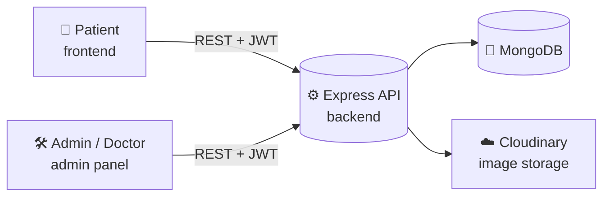
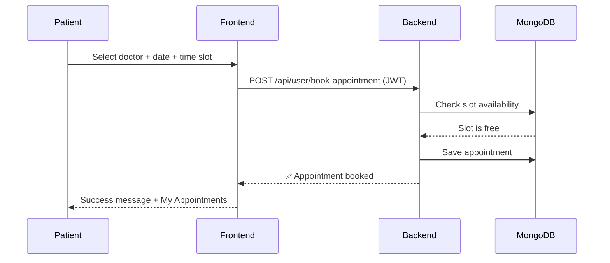

<div align="center">

# 🩺 Prescripto

### Doctor Appointment Booking Platform

**Book doctor appointments in seconds. Patients · Doctors · Admins, all in one platform.**

🌐 **[Live Demo → prescripto-coral-three.vercel.app](https://prescripto-coral-three.vercel.app)**

`React` · `Node.js` · `Express` · `MongoDB` · `Tailwind CSS` · `JWT` · `Vercel`

</div>

---

## 📑 Table of Contents

- [✨ About the Project](#-about-the-project)
- [🎯 Key Features](#-key-features)
- [🧰 Tech Stack](#-tech-stack)
- [🏗️ Architecture](#️-architecture)
- [📂 Project Structure](#-project-structure)
- [🚀 Getting Started (Run Locally)](#-getting-started-run-locally)
- [🔐 Environment Variables](#-environment-variables)
- [🌍 Steps to Go Live (Deployment)](#-steps-to-go-live-deployment)
- [🔌 API Overview](#-api-overview)
- [🗺️ Roadmap](#️-roadmap)
- [🤝 Contributing](#-contributing)
- [👩‍💻 Author](#-author)

---

## ✨ About the Project

**Prescripto** is a full-stack **doctor appointment booking platform** that connects patients with healthcare professionals. Patients can browse doctors by speciality, check availability and book a slot in a few clicks. Doctors manage their own appointments and profile, while admins control the whole system from a dedicated dashboard.

The project is split into **three independent apps**, so each role gets its own focused experience:

| App | Who uses it | Purpose |
|---|---|---|
| 🧑‍⚕️ **`frontend`** | Patients | Browse doctors, book / cancel appointments, manage profile |
| 🛠️ **`admin`** | Admin & Doctors | Manage doctors, appointments and dashboard stats |
| ⚙️ **`backend`** | All apps | REST API, authentication, database and business logic |

> 🔗 **Live:** [prescripto-coral-three.vercel.app](https://prescripto-coral-three.vercel.app)

---

## 🎯 Key Features

### 👤 Patient Portal
- 🔍 Browse all doctors and **filter by speciality**
- 📅 Real-time **appointment slot booking**
- 🔐 Secure **sign up / login** with JWT authentication
- 🧾 View, manage and **cancel** your appointments
- 👤 Update personal profile and profile picture
- 📱 Fully **responsive** on mobile, tablet and desktop

### 🛠️ Admin Dashboard
- ➕ **Add new doctors** with image, speciality, fees and about info
- 📋 View and manage **all appointments**
- 👨‍⚕️ Toggle doctor **availability**
- 📊 Dashboard with quick stats (doctors, patients, appointments)

### 🩺 Doctor Panel
- 📆 See upcoming appointments
- ✅ Mark appointments as **completed** or **cancelled**
- 🧑‍💼 Edit own profile, fees and availability

---

## 🧰 Tech Stack

| Layer | Technologies |
|:---:|:---|
| **Frontend** | React, React Router, Tailwind CSS, Axios, React Toastify |
| **Admin Panel** | React, Tailwind CSS, Context API |
| **Backend** | Node.js, Express.js |
| **Database** | MongoDB + Mongoose |
| **Auth** | JSON Web Tokens (JWT), bcrypt |
| **File Uploads** | Multer + Cloudinary |
| **Deployment** | Vercel |

> ℹ️ Adjust this table if your exact libraries differ (for example the payment gateway, or Vite vs CRA).

---

## 🏗️ Architecture



**Booking flow**



---

## 📂 Project Structure

```bash
Prescripto/
├── 📁 frontend/     # Patient-facing React app
├── 📁 admin/        # Admin & Doctor dashboard (React)
└── 📁 backend/      # Node.js + Express REST API
```

---

## 🚀 Getting Started (Run Locally)

### ✅ Prerequisites

- [Node.js](https://nodejs.org/) **v18+**
- [Git](https://git-scm.com/)
- A [MongoDB Atlas](https://www.mongodb.com/atlas) account (or local MongoDB)
- A [Cloudinary](https://cloudinary.com/) account (for image uploads)

### 1️⃣ Clone the repository

```bash
git clone https://github.com/Eman-Nazir/Prescripto.git
cd Prescripto
git checkout development
```

### 2️⃣ Start the Backend

```bash
cd backend
npm install
# create the .env file (see Environment Variables below)
npm run server        # or: npm start
```

Backend runs on **http://localhost:4000** (or the port you set).

### 3️⃣ Start the Frontend (Patients)

```bash
cd ../frontend
npm install
npm run dev
```

Open **http://localhost:5173**

### 4️⃣ Start the Admin Panel

```bash
cd ../admin
npm install
npm run dev
```

Open **http://localhost:5174** (Vite picks the next free port automatically).

---

## 🔐 Environment Variables

Create a `.env` file inside each folder. **Never commit these files.**

<details>
<summary><b>📁 backend/.env</b> (click to expand)</summary>

```env
PORT=4000
MONGODB_URI=your_mongodb_connection_string
JWT_SECRET=your_super_secret_key

# Cloudinary
CLOUDINARY_NAME=your_cloud_name
CLOUDINARY_API_KEY=your_api_key
CLOUDINARY_SECRET_KEY=your_api_secret

# Admin login
ADMIN_EMAIL=admin@example.com
ADMIN_PASSWORD=your_admin_password
```

</details>

<details>
<summary><b>📁 frontend/.env</b> (click to expand)</summary>

```env
VITE_BACKEND_URL=http://localhost:4000
```

</details>

<details>
<summary><b>📁 admin/.env</b> (click to expand)</summary>

```env
VITE_BACKEND_URL=http://localhost:4000
```

</details>

> ⚠️ Variable names must match what your code reads (`process.env.X` / `import.meta.env.X`). Rename them here if yours differ.

---

## 🌍 Steps to Go Live (Deployment)

The project is deployed on **Vercel**. Since there are three apps, you deploy **three separate Vercel projects** from the same repo.

### 🅰️ Step 0: Prepare MongoDB & Cloudinary
1. Create a free cluster on **MongoDB Atlas**.
2. Go to **Network Access** and allow `0.0.0.0/0` (so Vercel can connect).
3. Copy your connection string and keep your Cloudinary keys ready.

### 🅱️ Step 1: Push code to GitHub
```bash
git add .
git commit -m "Ready for deployment"
git push origin development
```

### 🅲 Step 2: Deploy the Backend
1. Go to [vercel.com](https://vercel.com) → **Add New → Project** → import `Prescripto`.
2. Set **Root Directory** to `backend`.
3. Add a `vercel.json` in `backend/` (needed to run Express on Vercel):
   ```json
   {
     "version": 2,
     "builds": [{ "src": "server.js", "use": "@vercel/node" }],
     "routes": [{ "src": "/(.*)", "dest": "server.js" }]
   }
   ```
4. Add all **backend environment variables** under *Settings → Environment Variables*.
5. Click **Deploy** and copy the backend URL (for example `https://prescripto-api.vercel.app`).

### 🅳 Step 3: Deploy the Frontend
1. **Add New → Project** → import the same repo.
2. Set **Root Directory** to `frontend`, Framework preset: **Vite**.
3. Add env variable: `VITE_BACKEND_URL = <your backend URL>`.
4. Add `frontend/vercel.json` so page refreshes don't return 404:
   ```json
   { "rewrites": [{ "source": "/(.*)", "destination": "/" }] }
   ```
5. Click **Deploy** 🎉

### 🅴 Step 4: Deploy the Admin Panel
1. Repeat the same process with **Root Directory** = `admin`.
2. Use the same `VITE_BACKEND_URL` and the same `vercel.json` rewrite.

### 🅵 Step 5: Final checks
- [ ] Enable **CORS** on the backend for your frontend and admin domains
- [ ] Test sign up → login → book appointment
- [ ] Test admin login → add doctor
- [ ] Redeploy after changing any environment variable

> 💡 Every push to your connected branch triggers an automatic redeploy on Vercel.

---

## 🔌 API Overview

> Example routes. Update them to match your `backend/routes` folder.

| Method | Endpoint | Description | Access |
|:---:|---|---|:---:|
| `POST` | `/api/user/register` | Register a new patient | Public |
| `POST` | `/api/user/login` | Login and receive JWT | Public |
| `GET` | `/api/user/get-profile` | Get logged-in user profile | 🔒 User |
| `POST` | `/api/user/book-appointment` | Book an appointment | 🔒 User |
| `GET` | `/api/user/appointments` | List user appointments | 🔒 User |
| `POST` | `/api/user/cancel-appointment` | Cancel an appointment | 🔒 User |
| `GET` | `/api/doctor/list` | Get all doctors | Public |
| `POST` | `/api/admin/login` | Admin login | Public |
| `POST` | `/api/admin/add-doctor` | Add a doctor | 🔒 Admin |
| `GET` | `/api/admin/dashboard` | Dashboard statistics | 🔒 Admin |

---

## 🗺️ Roadmap

- [x] Patient authentication & profile
- [x] Doctor listing with speciality filter
- [x] Appointment booking & cancellation
- [x] Admin dashboard
- [ ] 💳 Online payments
- [ ] 📧 Email / SMS appointment reminders
- [ ] ⭐ Doctor ratings and reviews
- [ ] 🌙 Dark mode
- [ ] 🎥 Video consultations

---

## 🤝 Contributing

Contributions are welcome!

1. **Fork** the repository
2. Create a branch: `git checkout -b feature/amazing-feature`
3. Commit: `git commit -m "Add amazing feature"`
4. Push: `git push origin feature/amazing-feature`
5. Open a **Pull Request**

---

## 👩‍💻 Author

<div align="center">

**Eman Nazir** · [GitHub @Eman-Nazir](https://github.com/Eman-Nazir)

⭐ **If you like this project, give it a star!** ⭐

</div>
